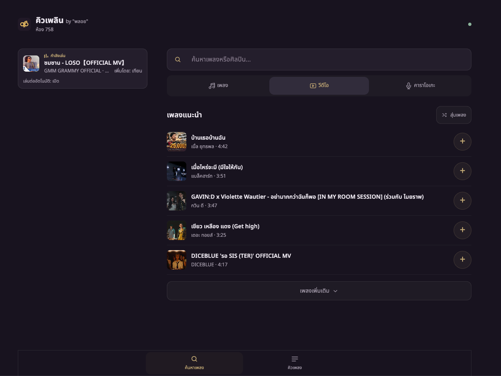

<div align="center">

# 🎶 คิวเพลิน

**Turn any projector into a crowd-powered jukebox.**

Guests scan a QR code, search YouTube from their phones, and queue songs.
The music plays on the big screen, with a shared queue and live playback controls.

[](https://bun.sh)
[](LICENSE)
[](#how-it-works)
[](#run-on-a-home-server-docker--reverse-proxy)


<em>The projected host screen: player, scan-to-add QR, live queue with requester credits.</em>

</div>

## Why this exists

Party playlists die in one of two ways: one person DJs all night, or an
unmoderated queue fills with memes and worse. This is the middle path — every
guest can add songs from their own phone in seconds (no app, no account), while
the host keeps light-touch control: skip, remove, and rate-limit.

Built for a real graduation dinner in Hong Kong; designed to work for any event.

## Features

- 📱 **Zero-friction requests** — scan QR → search → tap. No app, no login.
- 🔑 **No YouTube API key** — search scrapes the public results page; playback
  uses the standard embedded player.
- 🎤 **Explore** — shows the configured country's charts (TH/th-TH by default)
  in every search mode, with shuffle and five-song batches.
- 🎛 **Live controls** — play/pause/skip, volume and remove tracks on Player/Admin;
  per-guest request cooldown (five seconds by default) on Admin. Each room has independent settings, queue and playback, held only in memory.
- 🔁 **Auto Queue** — enabled by default, with YouTube video recommendations after requested songs run out;
  Player/Admin can toggle it, and new requests play after the current automatic song finishes.
- 🔒 **Rooms** — three-digit codes and direct QR entry. Append the digit sum to create/join Player (`1236` → room `123`). The first participant automatically becomes Admin; later participants join as Guests. Admin grants/revokes Controller rights; Controllers can grant them to Guests.
- 📺 **Multiple Players** — concurrent screens share song, queue, pause and volume. Each new Player starts the current song from the beginning; song positions are independent.
- ↩️ **Cancel deletion** — Admin/Controller queue removals wait five seconds, with a separate countdown and cancel button per song. Drag reorder and Play Now remain available.
- 📲 **Installable** — qp music-note icon, Chrome desktop/Android installation and
  iPhone/iPad Add to Home Screen. Opens the shared entry screen as a standalone app.
- 🛡 **Queue guardrails** — duplicate rejection, per-phone cooldown (works
  behind venue NAT), 50-song cap, playability pre-check, and a watchdog that
  skips videos that fail to start.
- ⚡ **Live everything** — room-scoped WebSocket broadcasts keep each projector and its
  phones in sync; guests see a "คุณ" badge on their own songs.

<div align="center">


<em>Earlier guest-page screenshot: Thai nickname, search, and one-tap requests.</em>
</div>

## Quick start

```bash
git clone https://github.com/attapon-th/event-music-system.git
cd event-music-system
bun install
cp .env.example .env      # configure PUBLIC_URL for your deployment
bun start
```

Open **http://localhost:45416/** on the machine, drag it to the projector, and press **เริ่มเล่น** to see four cards. Either **สร้างห้องเล่นเพลง** card uses a suggested free three-digit number and opens the Player. To create or join a specific Player room, enter its three-digit number (`100–999`) on **สร้างหรือเข้าร่วมเครื่องเล่น**. The same card offers a shortcut back to the last Player room when available.

**เข้าร่วมจัดคิวเพลง** takes the three-digit room number and preserves any saved Admin/Controller role. The first participant goes straight to Admin at `/a`, and later participants enter Guest. If the room is missing, the page displays **ไม่มีห้องนี้**. Both forms use a numeric keyboard on mobile. On a TV remote, use the arrow keys to move and OK to select. The legacy `HOST_PASSWORD` is ignored.
New rooms start at **60% volume**. If the browser blocks audio, use its existing
play button. The QR is hidden when the Player opens. Press **แสดง QR** to let
guests scan it, or guests can join directly at `/guest`.

> Node ≥ 20 works too (`npm install && npm start`), but Bun is what the Docker
> image and scripts use.

## Admin และ Guest

ทั้งสองหน้าใช้ `public/music-ui.css` ร่วมกันสำหรับธีมม่วงเข้ม–ทองหม่น รายการเพลง,
player metadata, search, segmented controls, bottom navigation, empty states และ toasts
ส่วน `guest.css` และ `admin.css` เก็บรูปแบบเฉพาะสิทธิ์ ใช้ Vanilla JavaScript เดิม ไม่มี framework เพิ่ม
เมื่อแก้ shared stylesheet ให้เปลี่ยนค่า `?v=` ในทั้งสอง HTML เพื่อป้องกัน browser cache เก่า

- Admin เปิดที่ **คิวเพลง** พร้อม Now Playing และ Play/Pause ตามสถานะจริง, Skip และปุ่มเปิด volume slider
  เมนู **⋯** มีเล่นตอนนี้, ย้ายขึ้น/ลง และลบ; ลบยังรอ 5 วินาทีและยกเลิกได้ ลากคิวได้เหมือนเดิม
  Keyboard ใช้ลูกศรในเมนู หรือขึ้น/ลงบน drag handle ได้; Escape/คลิกภายนอกปิดเมนู
- Settings รูปเฟืองรวม Auto Queue และเวลารอขอเพลง; ล้างคิวยังคงซ่อนตามเงื่อนไขเดิมและมี confirmation
  ผู้เข้าร่วมและคำสั่งให้/ถอนสิทธิ์ยังแสดงเฉพาะ Admin/Controller ตามสิทธิ์เดิม
- Guest เปิดที่ **ค้นหา** พร้อมเพลงแนะนำ มี mini player สำหรับดูสถานะ และคิวแบบอ่านอย่างเดียว
  ช่องค้นหามีปุ่มล้างคำค้น ผลลัพธ์/ตำแหน่ง scroll คงอยู่เมื่อเพิ่มเพลง และป้องกันคำขอเพลงเดียวกันซ้ำระหว่างรอ
- มือถือใช้ navigation ด้านล่างพร้อม safe area; desktop แยก player และเนื้อหาเป็นสองคอลัมน์
  API, WebSocket, session/room, YouTube และหน้า Player ใช้ระบบเดิม

## How it works

```
   Projector (laptop / server)        Guests' phones
  ┌────────────────────┐             ┌──────────────┐
  │  ▶ Now Playing     │   scan QR   │  🔍 search   │
  │  [ YouTube video ] │  ◀───────▶  │  + add song  │
  │  ▣ QR   Up Next ▤▤ │   Wi-Fi     │  live queue  │
  └────────────────────┘             └──────────────┘
            │ audio out → venue AV system
```

| Path | Purpose |
|------|---------|
| `/` | Four-card entry: join as a participant, choose either suggested free room for Player, or create/join a specific Player room |
| `/guest` | Mobile page guests open via the QR |
| `/explore` | Alias of the Guest page with Thailand charts on first load |
| `/a` | Admin/Controller controls, queue editing and participant roster |
| `/g` | Redirect to `/guest`, preserving room/session query parameters |
| `POST /api/sessions` | `{ code: "1236" }` → create/reuse room `123` and issue a Player credential; concurrent requests reuse one room |
| `GET /api/sessions/available` | Returns `{ codes }` with up to two distinct unused room numbers |
| `POST /api/sessions/random` | `{ code: "234" }` → create a new room and issue a Player credential, or return `409` if the room number is already used |
| `POST /api/sessions/join` | `{ code, sessionId? }` → first participant becomes Admin automatically, later participants become Guests; reuses a valid member credential |
| `POST /api/sessions/close` | Player credential → delete room and disconnect everyone |
| `GET /api/search?q=&mode=songs\|karaoke\|videos` | YouTube Music songs, karaoke or videos (no API key); video queries are unchanged and results keep YouTube order, including live and long videos |
| `GET /api/browse?q=` | Cached, singles-only search behind the explore tabs |
| `POST /api/request` | Room member credential → guardrails → playability check → enqueue |
| WebSocket `/` | Authenticate first; room-scoped state and authorized controls |

The **server owns a queue per room** (`src/state.js`, `src/sessions.js`). The
Player reports completion/errors so that its room advances and broadcasts.
Everything is in memory: queue, history, settings, admission and credentials.
Rooms expire after the last connection has been gone for 60 minutes. A connected
idle page keeps its room alive; heartbeat detects dead connections. A restart
clears every room. Run one server process, with at most 900 concurrent rooms.
Active Player credentials use per-tab `sessionStorage`; the browser also remembers its
last Player room and credential for validation when the user selects the resume button on **สร้างหรือเข้าร่วมเครื่องเล่น**.
Explicit Leave forgets that matching record; expired/replaced rooms require entry again.
Participant credentials retain
`localStorage`. Opening another Player never disconnects existing ones, even
when a duplicated tab shares its credential. **ออก** stops and disconnects only
that Player page and returns it to welcome; the room and other devices remain.
The explicit close API is separate and is not used by this button.

By default, losing the server connection leaves the Player playing its current
song and the upcoming queue from its last snapshot. It retries authentication
with the same room credential. On reconnect, finished queue item IDs reconcile
with the live room before its first snapshot, so the current song continues
without restarting and new requests remain queued. Guest/Admin reconnects keep
their membership and roles while the room exists. If the room disappeared after
a restart or expiry, the Player finishes its cached queue before returning to
the room creation screen. Explicit room closure still stops it immediately.
Keep the Player page open during an outage: the
cached queue is in browser memory, and playback still needs access to YouTube;
Auto Queue recommendations require the server connection.

Application stdout contains only JSON `created` / `deleted` records with `at`,
`room`, and `sessionId`. The app writes no session or log files. Existing
`data/settings.json` is ignored and the Compose settings volume is removed.

Request pipeline: flood control → duplicate/cap checks → oEmbed playability
check → enqueue. Embed-disabled or region-locked videos
that slip through are auto-skipped by the player (iframe error codes + a 20s
never-started watchdog).

## AI paused

AI moderation is disabled and outside the current development scope. The server
does not call an LLM or fetch moderation metadata when adding a request, even if
legacy AI environment settings are present. `setFilter` cannot enable it.

The moderation module and standalone diagnostic script remain for future work.
Legacy API fields are retained for compatibility: `filterOn` and
`moderationConfigured` report `false`; `moderationMode` remains `default`.
Event context is retained as inert metadata, with an empty initial value.

## Run on a home server (Docker + reverse proxy)

Compose builds the image from source and tags it as `attap0n/qp:latest`:

```bash
git clone https://github.com/attapon-th/event-music-system.git
cd event-music-system
cp .env.example .env          # set DOMAIN and PUBLIC_URL to your domain
docker compose up -d --build
```

To use the published Docker Hub image instead of building locally:

```bash
docker compose pull
docker compose up -d --no-build
```

The container joins the external `proxy` Docker network. Traefik's Docker provider
reads the container labels and routes `https://${DOMAIN}` through the `websecure`
entrypoint to the app's `PORT` (default `45416`), with TLS certificates managed by
the `cloudflare` resolver. Traefik must share the `proxy` network and already have
that entrypoint and resolver configured. Set `DOMAIN` to your hostname without a
scheme (default `grad-din-music.hangton.net`) and `PUBLIC_URL` to the matching HTTPS
URL for guest QR codes. In Compose, an empty `PUBLIC_URL` defaults to `https://${DOMAIN}`.
Traefik forwards **WebSocket upgrades**. All rooms and settings are temporary;
no data volume is needed.

> The `proxy` network must already exist (it does if your proxy created
> it). If not: `docker network create proxy`.

### Keeping it updated

**Push-to-deploy (recommended)** — a self-hosted GitHub Actions runner rebuilds
on every push to `main` (`.github/workflows/deploy.yml`). One-time setup:

1. **Register the runner** — repo → **Settings → Actions → Runners → New
   self-hosted runner**, pick Linux, run the shown commands on the home server
   as the user that owns your clone, then `sudo ./svc.sh install <youruser> &&
   sudo ./svc.sh start`.
2. **Docker access** — `sudo usermod -aG docker <youruser>` (re-login after).
3. **Clone location** — the workflow deploys `~/event-music-system` by default;
   set a repo Variable `DEPLOY_DIR` if yours lives elsewhere.

**Manual** — `git pull && docker compose up -d --build` whenever you like.
**Cron** — `update.sh` pulls and rebuilds only when something changed (use the
runner *or* cron, not both).

> **Security note:** self-hosted runners + a public repo need care. This
> workflow triggers only on direct pushes to `main` and manual dispatch — never
> on `pull_request` — so forks can't execute code on your runner. Keep it that
> way.

## ⚠️ The #1 thing that breaks at events: the network

Guests' phones must be able to reach the server. Many **venue/guest Wi-Fi
networks block device-to-device traffic** ("client isolation"), so the QR code
loads nothing even though everything is configured correctly.

Reliable fixes (pick one):

- **Host it publicly** behind a domain (the Docker setup above) — phones use
  their own data; nothing to debug at the venue.
- **Run your own hotspot** and have guests join it.
- **Bring a travel router** and put everyone on its network.

The host machine always needs internet for YouTube playback.

## Configuration

Everything lives in `.env` (see [`.env.example`](.env.example) for the full,
commented list). The highlights:

| Variable | What it does |
|----------|--------------|
| `DOMAIN` | Traefik hostname in Compose, without a scheme (default `grad-din-music.hangton.net`) |
| `PUBLIC_URL` | Public address the QR code points to (behind a reverse proxy) |
| `DEFAULT_REGION` | YouTube search/chart country, fallback `TH` |
| `DEFAULT_LOCALE` | YouTube language/locale, fallback `th-TH` |
| `PORT` | Listen port (default `45416`) |

Cooldown is editable from Admin/Controller, with its value shown on the button.
AI environment settings are inactive while AI is paused. Each room's runtime
changes last only for that Session. Legacy `HOST_PASSWORD` has no effect, and the
server starts without it.

## Project layout

```
server.js                  Express + room-scoped WebSocket API and request pipeline
src/youtube.js             No-key search/recommendations, oEmbed check, watch-page details
src/auto-queue.js          Room-scoped recommendation preparation and late-reply guards
src/moderation.js          Retained LLM content filter (paused; unused by the server)
src/state.js               Authoritative in-memory queue
src/sessions.js            Room lifecycle and credentials
src/net.js                 LAN IP detection
public/host.*              Projector page (player, QR, controls)
public/guest.*             Mobile page (search, explore, live queue)
public/admin.*             Authorized room controls and queue drag/drop
public/session.*           Shared entry forms, credentials and reconnects
public/i18n.js             Shared Thai UI dictionary + interpolation
public/pwa.js              Native installation prompt and iOS home-screen help
public/manifest.webmanifest Shared install identity and launch configuration
public/icons/              SVG qp logo and PNG app icons
scripts/test.mjs           HTTP/WebSocket integration checks (isolated temporary server)
scripts/test-auto-queue.mjs Auto Queue checks with simulated YouTube responses
scripts/check-llm.mjs      Retained standalone LLM diagnostic (outside current development)
Dockerfile                 Bun-based image
docker-compose.yml         Home-server deployment (builds locally)
update.sh                  Cron alternative: pull + rebuild if changed
```

No frameworks, no build step, three dependencies (`express`, `ws`, `qrcode`).


## ใช้งานคิวเพลิน

ตั้งค่าใน `.env` ก่อนเปิด Player/Admin:

```ini
DEFAULT_REGION=TH
DEFAULT_LOCALE=th-TH
```

เปิด `/` บน TV/TV Box แล้วกด **เริ่มเล่น** จะเห็นการ์ด 4 ใบ เรียง 2 × 2 บนจอกว้างและคอลัมน์เดียวบนมือถือ

- **เข้าร่วมจัดคิวเพลง** กรอกเลขห้อง 3 หลักเพื่อเข้า Guest หรือกลับ Admin/Controller ตามสิทธิ์เดิม หากไม่พบจะแจ้ง **ไม่มีห้องนี้**
- **สร้างห้องเล่นเพลง** สองใบกลางแสดงเลขห้องว่างที่สุ่มมาโดยไม่ซ้ำกัน กดแล้วสร้างเฉพาะห้องที่เลือกและเปิดจอเล่นเพลงทันที เมื่อเลขนั้นถูกใช้ระหว่างเลือก ระบบจะแสดงตัวเลือกใหม่
- **สร้างหรือเข้าร่วมเครื่องเล่น** กรอกเลขห้อง `100–999` เพื่อสร้างห้องและเปิดจอเล่นเพลง ถ้ามีห้องแล้วจะเปิด Player เพิ่มในห้องเดิม

ทั้งสองช่องใช้คีย์บอร์ดตัวเลขบนมือถือ บน TV Box ใช้ลูกศรเลื่อนระหว่างการ์ด กด OK เพื่อเลือกหรือเปิดช่องกรอกเลข และใช้ลูกศรลงเพื่อไปยังปุ่มส่ง
หากเซิร์ฟเวอร์ปฏิเสธเลขที่ส่ง ระบบจะแสดงเวลารอส่งซ้ำ ทั้งปุ่มและ Enter
ยังแก้ข้อความระหว่างรอได้ ปัญหาเครือข่ายไม่เริ่ม cooldown นี้
เมื่อสร้างสำเร็จ Player เปิดทันที ห้องใหม่เริ่มที่ระดับเสียง **60%**
หาก browser บล็อกเสียง ให้กดปุ่มเล่นเดิม; ระบบไม่ข้ามเพลงเพราะถูกบล็อก autoplay
ห้องมีเลข 3 หลัก (`100–999`) และ QR ผู้ฟัง scan QR เข้าห้องทันที
หรือเปิด `/guest` กรอกเลขห้องโดยไม่ต้องเลือกบทบาท

ผู้เข้าร่วมห้องคนแรกผ่าน QR หรือเลขห้องเป็น **ผู้ดูแลหลัก (Admin)** อัตโนมัติ และเข้าหน้า `/a` ทันที
คนถัดไปเข้าหน้า Guest โดยไม่ต้องกดรับสิทธิ์; Player ที่สร้างห้องยังเป็นเครื่องเล่น
Admin เดิมยังคงสิทธิ์เมื่อ refresh/reconnect หรือกลับเข้าห้อง และไม่มีการส่งต่อสิทธิ์เพราะออฟไลน์
Admin และ **ผู้ช่วยควบคุม (Controller)** เห็นแท็บผู้เข้าร่วมพร้อมสถานะออนไลน์
Controller ควบคุมเพลงและการตั้งค่า และให้สิทธิ์ Controller กับ Guest ในห้องเดียวกันได้
ปุ่มให้สิทธิ์ของ Controller แสดงเฉพาะ Guest; ถอนสิทธิ์ไม่ได้ ส่วน Admin ยังให้และถอนสิทธิ์ได้
สิทธิ์ Admin และ Player เปลี่ยนไม่ได้ทั้งหน้าเว็บและคำสั่งตรงผ่าน WebSocket
เมื่อได้รับสิทธิ์ browser เปลี่ยนไป `/a` ทันที; เมื่อถูกถอนกลับ `/guest` ทันที
รายชื่อเก็บทุกคนที่เคยเข้าห้องจนห้องจบ พร้อมสถานะออนไลน์/ออฟไลน์
ชื่อเล่นใช้แสดงผลเท่านั้น สิทธิ์ตรวจด้วยกุญแจที่ server ออกให้ โดยไม่ส่งกุญแจในรายชื่อ

เมื่อเปิด Player การ์ด QR จะซ่อนอยู่ กด **แสดง QR** เพื่อเปิดการ์ด ข้อความใต้ QR คือ `ห้อง {rn} · yt1.lkzlab.uk/guest`
ปุ่มประเภทงานบน Player ซ่อนไว้ หน้า `/a` ไม่มีปุ่มตัวกรองและซ่อนปุ่มล้างคิว
เวลารอเพิ่มเพลงเริ่มต้นที่ **5 วินาที** ปุ่มเวลารอแสดงค่าในปุ่มโดยตรง ไม่มี label การตั้งค่าด้านล่าง
ปุ่ม **ออก** หยุดเสียงและตัดการเชื่อมต่อเฉพาะ Player หน้านั้น แล้วกลับหน้าเริ่ม ห้องและเครื่องอื่นยังอยู่
Player เก็บกุญแจที่ใช้งานใน `sessionStorage` แยกแต่ละแท็บ และจำห้องล่าสุดพร้อม Session ID/กุญแจใน `localStorage`
หลังเปิดหน้าแรกแล้วกด **เริ่มเล่น** เลือก **กลับเข้าห้องล่าสุด** บนการ์ด **สร้างหรือเข้าร่วมเครื่องเล่น** ระบบจะตรวจ `/api/info` ก่อนเปิดห้องเดิม
หากห้องหมดอายุ ถูกลบ หรือเลขห้องถูกใช้ใหม่ ระบบจะลืมข้อมูลเดิมและให้เลือกห้องจากการ์ดได้อีกครั้ง
เครือข่ายขัดข้องชั่วคราวยังจำห้องไว้เพื่อให้ลองใหม่ได้ การกด **ออก** ลืมข้อมูลกลับเข้าห้องนั้นโดยไม่ตัด Player อื่น
ผู้เข้าร่วมยังใช้ `localStorage` ตามเดิม

ข้อมูลทุกห้องอยู่ใน memory ของ server ลบหลังไม่มีอุปกรณ์เชื่อมต่อครบ 60 นาที
หรือหายเมื่อ restart หน้า Guest/Admin จะแสดงฟอร์มเลขห้องเมื่อห้องหมดอายุ
หากเพียงเน็ตหลุดจะเชื่อมต่อห้องเดิมใหม่ Browser เก็บกุญแจเฉพาะห้องไว้กลับเข้า
กุญแจและ QR ของ session เก่าใช้เข้าห้องใหม่ที่ได้เลขซ้ำไม่ได้

หน้า Host ใช้ลูกศรรีโมตเลือกปุ่มและกด **OK/Enter** ได้ (ปุ่มเล่น/หยุดถูกเลือกไว้แล้ว)
ปรับเสียงด้วยซ้าย/ขวาขณะเลือกแถบเสียง ใช้ขึ้น/ลงเพื่อออกจากแถบเสียง
ปุ่มมุมขวาบนวิดีโอหรือ **F** เปิดวิดีโอเต็มจอ ปุ่มนี้ซ่อนขณะเต็มจอ
กด **Back/Esc**, Back บนรีโมต TV หรือปุ่มย้อนกลับของ browser เพื่อกลับหน้า Player ปกติในห้องเดิม
Browser ที่ไม่มี Fullscreen API จะขยายวิดีโอเต็มพื้นที่หน้าเว็บแทน รองรับปุ่มสื่อเล่น/หยุดและข้ามเพลงด้วย
Guest แยก **ค้นหาเพลง** และ **คิวเพลง** เป็นคนละแท็บ; Admin/Controller มีแท็บผู้เข้าร่วมพร้อมไอคอนกลุ่มคนเพิ่ม โดยคิวยังอัปเดตสดขณะอยู่แท็บค้นหา
กดปุ่มโหมด **วีดีโอ / คาราโอเกะ / เพลง** ได้ในแท็บค้นหา โดย Guest/Admin เริ่มต้นที่ **วีดีโอ**: เพลงใช้ YouTube Music หมวด Songs
ส่วนคาราโอเกะใช้วิดีโอ YouTube และเติมคำว่า `karaoke` หากคำค้นยังไม่มีคำนี้หรือ “คาราโอเกะ”
วีดีโอส่งคำค้นเดิมไป YouTube โดยไม่เติมคำ ไม่กรองเนื้อหาหรือความยาว รวมไลฟ์และวิดีโอยาว และแสดงตามลำดับที่ YouTube ส่งกลับ โดยรับเฉพาะวิดีโอ ไม่รวมช่องหรือเพลย์ลิสต์
Guest และ Admin มีเพลงแนะนำจากชาร์ตประเทศตาม `DEFAULT_REGION` เหมือนกันทุกโหมด โดยไม่มีปุ่มหมวด “ทั้งหมด”
ปุ่มโหมดใช้กับการค้นหา ส่วนปุ่มสุ่มใช้เฉพาะชาร์ตประเทศ ไม่มีหมวดหรือรายชื่อศิลปิน
ชาร์ตตัดรายการที่ไม่ทราบความยาวหรือยาวเกิน 10 นาที สุ่มลำดับ และแสดงเพิ่มครั้งละ 5 เพลงจากผลที่โหลดแล้ว
ทุกโหมดเพิ่มเข้าคิวของห้องเดียวกันและเล่นบน Player ของห้องนั้น
`/api/search` และ `/api/browse` รองรับ `mode=songs` (ค่าเริ่มต้น) หรือ `mode=karaoke` / `mode=videos`
คำค้น `__hits` และ `__hk_hits` ของ `/api/browse` ใช้ชาร์ตประเทศทุกโหมด โดยแชร์ cache 30 นาทีเดียวกัน

Guest/Admin สุ่มชื่อเล่นภาษาไทยจาก 100 ชื่อ เก็บแยกตาม session ใน browser และแสดง `คิวเพลิน by "{nickname}"`
เข้าห้องใหม่สุ่มชื่อใหม่ที่ต่างจากชื่อก่อนหน้า; refresh, reconnect หรือสลับ Guest/Admin ในห้องเดิมใช้ชื่อเดิม
หน้า Guest ไม่มีข้อความ Add a Song และใช้ `/g` เพื่อ redirect ไป `/guest` ได้
แท็บค้นหา/คิวมีไอคอน ช่องค้นหาใช้ตัวอักษร 16px และข้อความยาวตัดบรรทัดอยู่ในกรอบ
ชื่อเล่นนี้ส่งเป็นชื่อผู้เพิ่มเพลงโดยไม่ต้องกรอกเอง ผลค้นหาและเพลงแนะนำแสดงครั้งละ 5 เพลง
กด **เพลงเพิ่มเติม** เพื่อแสดงเพิ่มอีกไม่เกิน 5 เพลง คิวเพลงยังแสดงครบ
ค้นหาเพลงต่างประเทศได้ตามปกติ ชาร์ตประเทศเลือกจาก YouTube ตาม `DEFAULT_REGION`
UI ใช้ภาษาไทยเป็นหลักและอังกฤษเป็นคำรอง ไม่มีข้อความจีนใน UI ที่กำหนดไว้
ข้อความ UI อยู่ใน `public/i18n.js`
ชื่อเพลงและข้อมูลศิลปินจาก YouTube แสดงตามต้นฉบับ

Admin/Controller แสดงชื่อเพลง รูป ระยะเวลาและชื่อผู้เพิ่ม รองรับลากจัดลำดับด้วยเมาส์/สัมผัส
เอาปุ่มเลื่อนขึ้น/ลงออก คำสั่ง **ล้างคิว** ลบเฉพาะเพลงที่รอ (ปุ่มซ่อนไว้)
กดลบในแท็บคิวแล้วเพลงยังอยู่ แสดงนับถอยหลัง **5 → 1** และปุ่ม **ยกเลิกการลบ** ก่อนส่งคำสั่งเมื่อครบเวลา
แต่ละเพลงนับแยกกัน กดซ้ำหรือคิวอัปเดตไม่เริ่มเวลาใหม่ ยกเลิกเมื่อเพลงออกจากคิว/เริ่มเล่น
เมื่อหลุดการเชื่อมต่อ เสียสิทธิ์ หรือออก/รีเฟรชหน้า จะยกเลิกการลบที่ยังรอทั้งหมด
**เล่นตอนนี้** เปลี่ยนเพลงปัจจุบันเป็นเพลงที่เลือก และเก็บเพลงที่เหลือไว้ตามลำดับเดิม
รีเฟรชหน้าแล้วรับ snapshot ปัจจุบันจาก server ทันที แต่ restart server จะล้าง queue
รวมถึงข้อมูลห้องและการตั้งค่าทั้งหมด เปิด Player หลายหน้าต่าง/เครื่องได้โดยเครื่องเดิมยังเล่นต่อ
ทุกเครื่องใช้เพลง คิว pause และ volume ร่วมกัน แต่ไม่ซิงก์ตำแหน่งเวลา เครื่องใหม่เริ่มเพลงปัจจุบันจากต้นเพลง

ปุ่ม **เล่นต่ออัตโนมัติ: เปิด/ปิด** อยู่บน Player และ Admin; Controller ใช้ได้ด้วย
ห้องใหม่เริ่มต้นเป็นเปิด และ Guest เห็นสถานะโดยเปลี่ยนค่าไม่ได้ เมื่อเปิดและคิวหลักว่าง
ระบบเตรียมวิดีโอแนะนำจาก YouTube ปกติตามคลิปล่าสุดเป็นชุดละสูงสุด **5 เพลง** แยกจากคิวหลัก โดยไม่ขึ้นกับโหมดค้นหา
เรียงตาม YouTube โดยไม่สุ่ม ดึง Recommendations ครั้งเดียวต่อชุด เล่น/ข้ามจนเพลงสุดท้ายจบแล้วจึงดึงชุดใหม่จากเพลงล่าสุด
แล้วเล่นต่อเมื่อเพลงปัจจุบันจบ หากยังไม่เคยมีเพลง จะรอผู้ใช้เพิ่มเพลงแรก
เลือกตามลำดับแนะนำ ตัดรายการซ้ำ ไลฟ์/ระยะเวลาไม่ทราบ และคลิปยาวเกิน 10 นาที พร้อมตรวจการเล่นได้
คลิปเพลงภาพนิ่งยังเล่นได้หาก YouTube แนะนำมา; ระบบใช้รายการแนะนำปกติโดยไม่บังคับเสียงอย่างเดียว
เพลงอัตโนมัติแสดงคำว่า **เพลงอัตโนมัติ** บนทุกหน้าจอ และคิวหลักยังนับเฉพาะคำขอของผู้ใช้
Admin/Guest แสดงรายการอัตโนมัติที่รอเล่นพร้อมจำนวน แยกใต้คิวหลักและไม่มีปุ่มจัดการ
เมื่อเพิ่มเพลงสำเร็จ ล้างรายการอัตโนมัติที่รอและยกเลิกผลลัพธ์ที่กำลังโหลดทันที
หากเพลงอัตโนมัติเล่นอยู่ เพลงปัจจุบันจะเล่นจบก่อน แล้วเล่นคิวหลักตามลำดับ และเตรียมชุดใหม่จากเพลงสุดท้ายของคิวผู้ใช้
ปิดปุ่มแล้วเพลงปัจจุบันเล่นต่อ แต่จะไม่เลือกเพลงอัตโนมัติถัดไป รีเฟรชหน้ายังคงค่าของห้อง

Auto Queue ใช้ประเทศ/ภาษาจาก `DEFAULT_REGION`/`DEFAULT_LOCALE` และไม่ใช้บัญชี YouTube ของผู้ฟัง
ตัดเพลงซ้ำกับเพลงปัจจุบัน คิวหลัก และประวัติ 100 เพลงล่าสุด รวมทั้งรายการที่ไม่ทราบความยาวหรือเกิน 10 นาที
ตรวจความพร้อมเล่นสูงสุด 20 รายการจากผลตอบกลับเดิมจนได้ 5 เพลง หากได้ไม่ครบใช้จำนวนจริง
หากโหลดไม่ได้หรือไม่มีเพลงที่เหมาะสม จะแสดงข้อความและหยุดรอ
หากเพลงอัตโนมัติเล่นไม่ได้ติดกัน 3 เพลง ระบบหยุดลองต่อ ผู้ใช้เริ่มรอบใหม่ได้ด้วยการปิด/เปิดปุ่มหรือเพิ่มเพลงใหม่
YouTube Music ใช้ endpoint ภายในซึ่งอาจเปลี่ยนรูปแบบได้; เมื่อหาเพลงต่อไม่ได้ คิวที่ผู้ใช้เพิ่มยังทำงานตามปกติ

### ติดตั้งบนมือถือและ desktop

ทุกหน้าใช้ manifest เดียวกัน ชื่อ **คิวเพลิน** พร้อมโลโก้ qp สีทองบนพื้นม่วง
เปิดผ่าน HTTPS (หรือ localhost สำหรับทดสอบ) แล้วใช้เมนู **ติดตั้ง** ของ Chrome desktop/Android
เมื่อ browser เสนอการติดตั้ง จะมีปุ่ม **ติดตั้งคิวเพลิน** เฉพาะหน้าแรกก่อนเข้าห้อง
iPhone/iPad ใช้ปุ่ม **เพิ่มไปยังหน้าจอโฮม** บนหน้าแรกเพื่อดูคำแนะนำ จากนั้นกดแชร์และเพิ่มไปยังหน้าจอโฮม
หลังติดตั้งเปิดเป็นหน้าต่าง standalone เริ่มที่ `/` เพื่อสร้างหรือเข้าห้อง ไม่ผูกกับเลขห้องที่หมดอายุได้
ปุ่มติดตั้งซ่อนเมื่อเปิดในแอปที่ติดตั้งแล้ว รอบนี้เพิ่มเฉพาะการติดตั้ง ไม่มี service worker หรือแคชออฟไลน์
ไอคอนหลักอยู่ใน `public/icons/qp.svg`; PNG และ ICO เป็นไฟล์ที่ raster จาก SVG เดียวกัน
ไอคอน maskable ใช้พื้นหลังทึบเต็มภาพและเก็บรูป qp ไว้ในวงกลม safe area กลางภาพ

### API และ WebSocket

ใช้ HTTP API เดิมสำหรับค้นหา/เพิ่มเพลง ไม่มี Admin queue REST API แยกชุด
`/api/info` เพิ่ม `defaultRegion` และ `defaultLocale` ส่วน `/api/browse?q=__hits`
โหลดชาร์ตประเทศ (`__hk_hits` ยังรองรับสำหรับ client เดิมและใช้ประเทศที่ตั้งค่า)

Room APIs คืน `{ code, sessionId, token, role, memberId }` โดยไม่ใช้ `/api/host-token` หรือ Basic Auth
`POST /api/sessions` รับ `{ code: "1236" }` และคืนเลขห้องสามหลักกับกุญแจ Player ใหม่ โดยใช้ session ID เดิมหากห้องมีอยู่
`GET /api/sessions/available` สุ่มเลขห้องว่างได้สูงสุดสองเลข `POST /api/sessions/random` รับเลขที่เลือกและสร้างห้องใหม่ หากมีห้องนั้นอยู่แล้วจะคืน HTTP 409
`POST /api/sessions/join` ที่ส่งเฉพาะเลขห้องจะคืน HTTP 410 พร้อมข้อความ **ไม่มีห้องนี้** เมื่อไม่พบห้อง
ส่ง `Authorization: Bearer TOKEN` สำหรับ `/api/info`, `/api/request`, การกลับเข้าห้องด้วยสิทธิ์เดิม และการปิดห้อง
ส่ง `X-Session-Id` เพิ่มได้เพื่อยืนยันว่ากุญแจตรงกับห้องที่ต้องการ
การกรอกเลขหรือรหัสผิดรวม 10 ครั้งต่อนาทีต่อ IP จะถูกปฏิเสธชั่วคราวด้วย HTTP 429
ข้อผิดพลาดในการเข้าห้องคืน `retryIn: 5` สำหรับเวลารอส่งซ้ำบน browser
HTTP 429 คืน `retryIn` เป็นวินาทีที่เหลือจริงของข้อจำกัดต่อนาที พร้อม header `Retry-After`

WebSocket `/` ต้องส่ง `{ "type": "auth", "token": "...", "sessionId": "..." }`
ก่อนอ่านคิวหรือควบคุม server ตอบ `{ "type": "auth", "ok": true, "role": "guest|admin|controller|player" }`
แล้วส่ง snapshot ของห้อง ทุกคำสั่งตรวจสิทธิ์บน server; Guest อ่านคิวได้อย่างเดียว
Admin/Controller/Player ควบคุมคิวได้ แต่ `ended`/`error` จาก client ใช้ได้เฉพาะ Player
Player เพิ่ม `completed: [{ id, videoId, failed: boolean }]` ใน `auth` ได้เพื่อแจ้งเพลงที่จบ/เล่นไม่ได้
ระหว่างหลุด สูงสุด 51 รายการ; server เลื่อนเฉพาะรายการที่ ID และ videoId ตรงกับเพลงปัจจุบัน
แล้วค่อยส่ง snapshot แรก ป้องกันการเล่นซ้ำและไม่ข้ามคำขอใหม่ของวิดีโอเดิม

| Event | Payload / ผลลัพธ์ |
| --- | --- |
| `state` | `{ state, code, sessionId, role, memberId, primaryAdminId, filterOn, moderationMode, cooldownSeconds, eventContext }`; Admin/Controller มี `participants: [{ id, name, role, online }]` โดยไม่มี credential |
| `setParticipantRole` | `{ id: participantId, enabled }`; Admin ให้/ถอน Controller ได้, Controller ส่งได้เฉพาะ `enabled: true` ให้ Guest ในห้องเดียวกัน; ห้ามแก้ Admin/Player |
| `sessionEnded` | ปิดห้อง (`ROOM_CLOSED`); เปิด Player เพิ่มไม่ตัดเครื่องเดิม |
| `reorder` | `{ ids: [queueItemId, ...] }` ต้องเป็น ID ครบทุกเพลง ห้ามซ้ำ; stale order ถูกปฏิเสธ |
| `clear` | ล้างเพลงที่รอทั้งหมด |
| `playNow` | `{ id }` เปลี่ยนไปเล่นเพลงในคิวทันที |
| `play` / `pause` | เปลี่ยนสถานะการเล่น แล้ว Player ใช้ IFrame API ตาม snapshot |
| `setVolume` | `{ volume: 0–100 }` ปรับเสียง Player ของห้องผ่าน snapshot |
| `setAutoQueue` | `{ enabled: true/false }`; Player/Admin/Controller เปิดหรือปิดการเล่นต่อเมื่อคิวหลักหมด |
| `skip`, `remove`, `move` | Event เดิม; `remove` ใช้ `{ id }`, `move` ใช้ `{ id, dir: "up"/"down" }` |
| `ended`, `error` | Player ส่ง `{ id: queueItemId, videoId, code? }`; ข้ามเฉพาะเมื่อทั้ง `id` และ `videoId` ตรงกับเพลงปัจจุบัน เหตุการณ์ซ้ำเลื่อนคิวครั้งเดียว |
| `error` (server → client) | `{ error: "ข้อความ" }` เมื่อไม่มีสิทธิ์หรือ reorder จาก queue เก่า |

`state` เพิ่ม `autoQueue` (boolean) และ `autoQueueStatus` (`idle`, `loading`, `ready`, `unavailable`)
`nowPlaying.autoQueued: true` ระบุเพลงอัตโนมัติ และ `state.autoQueueItems` เป็นรายการ metadata เพลงอัตโนมัติที่รอเล่น
สูงสุด 5 เพลง เรียงตาม YouTube (`videoId`, `title`, `channel`, `duration`, `thumbnail`, `autoQueued: true`)
รายการนี้ไม่รวมใน `state.queue` และจะได้ queue item ID เมื่อถูกเลือกเป็น Now Playing

### ทดสอบ

```bash
bun install
bun run test
```

ใช้ Node assertions และ HTTP/WebSocket จริงใน directory ชั่วคราว จำลองเฉพาะ YouTube
ตรวจลำดับโหลด YouTube API ของ Host ด้วย: ลงทะเบียน callback ก่อนโหลด API
เพื่อให้ Player เริ่มเล่นได้แม้ API โหลดเร็วจาก cache (ทดสอบนี้จำลอง Player)
รวมการเลือกปุ่มด้วยรีโมต, OK, ปุ่มสื่อ และเต็มจอแบบ native/fallback โดยจำลอง DOM และ Fullscreen API
ไม่แตะ `.env`, queue หรือ settings ของระบบที่กำลังใช้งาน ครอบคลุมการเพิ่มเพลง, sync
Admin/Player/Guest, reorder, ลบ, clear, play now, play/pause/skip/volume,
refresh/reconnect, สิทธิ์ผู้ใช้/startup โดยไม่ตั้ง `HOST_PASSWORD`, ตรวจผลบวกในรหัส Player และ input validation,
คำขอเพลงซ้ำพร้อมกัน และ country/locale ที่ส่งไป YouTube
รวมหลายห้อง สร้างเลขเดียวกันพร้อมกัน เข้าร่วมพร้อมกันแล้วได้ Admin เพียงคนเดียว
Controller ให้สิทธิ์ Guest ได้แต่ถอน/แก้ Admin/Player/ข้ามห้องไม่ได้แม้ส่งคำสั่งตรง; Admin ยังถอนสิทธิ์ได้
Player หลายเครื่อง รายงานจบซ้ำ/ID เก่า ออกเฉพาะแท็บ กลับเข้า ปิดห้อง เลขซ้ำ ห้องเต็ม
หมดอายุ connection ที่ไม่ตอบ heartbeat คำขอที่ค้างตอนหมดอายุ และ log เฉพาะสร้าง/ลบห้อง
รวม Auto Queue: แปลงวิดีโอแนะนำทั้ง lockupViewModel/compactVideoRenderer, ตรวจคำขอ WEB ที่ไม่บังคับเสียงอย่างเดียว,
เตรียมเพลงนอกคิว, ให้คิวหลักมาก่อน, เล่นต่อหลายเพลง,
ปิด/เปิดหรือเพิ่มเพลงขณะโหลด, pause ขณะรอ, ปิดห้องขณะโหลด, เพลงซ้ำและจำนวนครั้งลองที่จำกัด
พร้อมตรวจปุ่มและสถานะบน Player/Admin/Guest โดยจำลอง YouTube และ DOM
รวม disconnect ระหว่างเล่น, เล่นคิวต่อขณะ offline, reconnect พร้อมซิงก์เพลงที่จบโดยไม่เล่นซ้ำ,
เพลงจบระหว่างรอ auth, ห้องหายแล้วรอคิวหมด, และชื่อใหม่เมื่อเปลี่ยน session
รวมการ์ดเข้าห้องและสร้างห้อง, เลขสุ่มชนกัน, เวลารอ 5 วินาที/HTTP 429, การข้ามแท็บผู้เข้าร่วมที่ถูกซ่อน,
ลบก่อน/ครบห้าวินาที ยกเลิก หลายเพลงพร้อมกัน คิวเปลี่ยนระหว่างรอ และยกเลิกเมื่อออกจากหน้า/เสียสิทธิ์/หลุดการเชื่อมต่อ,
เพลงแนะนำใช้ชาร์ตประเทศทุกโหมดโดยไม่มีปุ่มหมวด, การแบ่งผลชาร์ต/สุ่ม/กันซ้ำ/ลองใหม่ และ manifest/ขนาดไอคอน/flow ติดตั้งโดยจำลอง browser events

เพิ่ม browser regression suite แบบเลือกเรียก ใช้ Chromium ที่ติดตั้งพร้อม system libraries อยู่แล้ว:

```bash
# ค้นหา Chromium ใน /usr/bin หรือ Playwright cache ให้อัตโนมัติ หรือระบุเอง
BROWSER_BIN=/path/to/chromium node scripts/test-browser.mjs
```

ใช้ dependency `ws` เดิมคุยกับ Chrome DevTools; ไม่เพิ่ม Playwright/runtime dependency
รัน server/room ชั่วคราวและ browser contexts แยกกัน ใช้ API/WebSocket จริง
จำลองเฉพาะบริการ YouTube และ thumbnail ใน fixture ไม่ใช้ mock UI state
ตรวจ 320/375/768/1440px, overflow, 44px targets, touch, keyboard, modal focus,
play/pause/skip/volume, move/drag/Play Now, ลบ/ยกเลิก, ค้นหา/โหมด/แบ่งหน้า/สุ่ม/ล้าง,
error/empty/duplicate/cooldown, scroll, nickname, role redirects, reconnect และ reduced motion
บันทึกภาพใน `/tmp/music-ui-screenshots` หรือ directory ที่ระบุด้วย `BROWSER_ARTIFACTS`
ยังต้องตรวจเสียง YouTube และ Safari/iPhone/TV Box จริงตาม checklist ด้านล่าง

ตรวจบน browser/TV จริงหลังตั้งค่า:

1. สร้างสองห้องด้วย `1236` และ `78924` ตรวจ Player เปิดทันที ทดสอบ `1001`, `99927` และรหัสผลบวกผิด/เลขนอกช่วง
   เปิดหลายหน้าต่างด้วยรหัสเดียวกันพร้อมกันต้องได้ห้องเดียว Scan QR คนแรกในแต่ละห้องต้องเปิดหน้า Admin อัตโนมัติ
   คนถัดไปต้องเปิดหน้า Guest โดยไม่มีปุ่มรับสิทธิ์ ตรวจว่าคิวไม่ปะปนและ Admin กลับเข้าห้องแล้วคงสิทธิ์เดิม
2. Guest ค้นหาและเพิ่ม 4 เพลง: เพลงแรกเริ่มเล่น และ Admin เห็นเพลงที่เหลือทันที
3. ตรวจแถวคิว Admin/Controller มี drag handle และปุ่ม ⋯ เพียงปุ่มเดียว; เล่นตอนนี้/ย้ายขึ้น/ลง/ลบอยู่ในเมนู
   ลาก queue แล้วตรวจ Guest/Player ว่าแสดงลำดับเดียวกัน และตรวจ Escape/คลิกภายนอกปิดเมนู
4. ลบเพลงแล้วตรวจยังอยู่ในคิวพร้อมนับ 5 → 1 กดยกเลิกก่อนครบเวลาต้องไม่ลบ
   ลบหลายเพลงแยกเวลา ตรวจคิวอัปเดตไม่เริ่มนับใหม่ และเล่นตอนนี้/เพลงออกจากคิวยกเลิกการลบ
   ตัดการเชื่อมต่อ ถอนสิทธิ์ หรือออก/รีเฟรชระหว่างรอ แล้วตรวจไม่มีคำสั่งลบตามหลัง
5. เปิด Player เพิ่มอีกเครื่อง ตรวจเพลงปัจจุบันเริ่มจากต้นโดยเครื่องเดิมยังเล่นต่อ
   กดหยุดชั่วคราว/เล่น/ข้าม และปรับเสียง: ตรวจเสียงกับภาพทุกเครื่อง รวม autoplay เมื่อเปิดเครื่องใหม่
   ให้หลายเครื่องรายงานเพลงจบพร้อมกัน ต้องเลื่อนคิวครั้งเดียว
6. รีเฟรช Admin: เพลง คิว สถานะ pause และ volume ต้องเหมือนเดิม
   ตรวจว่าห้องใหม่เปิดเล่นต่ออัตโนมัติและเวลารอเพิ่มเพลง 5 วินาที ตรวจสถานะทั้งสามหน้าและห้องอื่น กดข้ามจนคิวหลักหมด
   ต้องมีวิดีโออัตโนมัติจากรายการแนะนำ YouTube เล่นต่อ ตรวจภาพและเสียงบน TV
   เพิ่มเพลงจาก Guest ระหว่างนั้น: เพลงใหม่ต้องเล่นหลังเพลงอัตโนมัติจบ
   ปิดปุ่มระหว่างโหลดและระหว่างเล่น ตรวจว่าเพลงปัจจุบันไม่ถูกหยุด และไม่มีเพลงอัตโนมัติถัดไป
7. ตรวจปุ่มประเภทงานบน Player และล้างคิวบน Admin ถูกซ่อน ไม่มีปุ่มตัวกรอง
   ปุ่มเวลารอแสดงค่าปัจจุบันและเปลี่ยนค่าได้ ตรวจช่องค้นหาบน iPhone และเพลงชื่อยาวไม่ดันปุ่ม + ออกข้างจอ
8. เปิด Guest/Admin โดยไม่มีห้องต้องเห็นฟอร์มเลขห้อง; WebSocket ไม่มี token ต้องไม่เห็นคิวหรือควบคุมได้
   ผู้ดูแลหลักให้/ถอน Controller ผ่านรายชื่อ ตรวจ redirect และ Controller ให้สิทธิ์ Guest ได้
   Controller ต้องไม่มีปุ่มถอนสิทธิ์/แก้ Admin/Player และส่งคำสั่งตรงหรือข้ามห้องก็ต้องถูกปฏิเสธ
9. เข้า `/explore` ของห้อง: โหลดชาร์ตประเทศไทยก่อน และยังค้นหาเพลงสากลได้
   กดออกบน Player ตรวจหยุดเฉพาะเครื่องนั้นและกลับหน้าเริ่ม เครื่องอื่นกับ Guest/Controller ยังอยู่ในห้อง
   เมื่อทุกคนออกครบหนึ่งชั่วโมงห้องจึงหมดอายุ
10. ตรวจ Docker ในเครื่องทดสอบ: `docker compose config --quiet` และ
    `docker compose up -d --build` (ต้องมี network `proxy` ร่วมกับ Traefik)
11. บน TV Box ตรวจเริ่มเล่นอัตโนมัติ; หาก browser บล็อกเสียง ใช้ปุ่มเล่นเดิม
    เลื่อนด้วยลูกศรไปเล่น/ข้าม/เสียง/ลบเพลง
    กรอบโฟกัสต้องเห็นชัดและยังอยู่เมื่อคิวอัปเดต เข้าเต็มจอแล้วปุ่มเต็มจอต้องซ่อน
    กด Back บน browser/รีโมต หรือ Esc เพื่อกลับ Player โดยห้องยังอยู่และเพลงยังเล่นต่อ
    ตรวจว่าภาพกับเสียงเล่นต่อและ layout ปกติกลับมาเหมือนเดิม
12. ตัดการเชื่อมต่อกับ server โดยยังให้ Player เข้าถึง YouTube ได้: เพลงเดิมต้องเล่นต่อ
    เมื่อเพลงจบต้องเล่นเพลงถัดไปจากคิวเดิม ต่อ server กลับ: ไม่ย้อนเพลงและไม่เริ่มเพลงปัจจุบันใหม่
    Guest/Admin ต้องกลับห้องเดิมพร้อมสิทธิ์เดิม จากนั้น restart server ให้ห้องหาย:
    Player ต้องเล่นคิวที่เหลือจนหมดแล้วกลับหน้าสร้างห้องใหม่
    ถ้าตัดอินเทอร์เน็ตของ Player ด้วย ให้ตรวจเพลงกลับมาเล่นเมื่อเข้าถึง YouTube ได้อีกครั้ง
13. เข้า Guest/Admin ห้องใหม่ตรวจชื่อสุ่มใหม่; refresh/reconnect ห้องเดิมตรวจชื่อไม่เปลี่ยน
14. หน้าแรกกรอกเลขห้องเพื่อเข้า Guest และรหัสสร้างเพื่อเปิด Player ตรวจรหัสผิดนับถอยหลัง 5 วินาที
    ที่การ์ด **เข้าร่วมจัดคิวเพลง** ลองกรอกเลขที่ยังไม่มีห้อง ต้องเห็น **ไม่มีห้องนี้**
    ลอง Enter ซ้ำระหว่างรอ และตรวจ Guest/Admin ไม่มีปุ่มหมวด “ทั้งหมด” หรือแถวศิลปิน
    สลับทั้งสามโหมดโดยไม่ค้นหา: เพลงแนะนำยังเป็นชาร์ตประเทศ สุ่มและแสดงเพิ่มครั้งละ 5 เพลงได้
15. Admin/Controller มีไอคอนผู้เข้าร่วมและสถานะออนไลน์ Guest ไม่ได้รับรายชื่อ
    ถอนสิทธิ์ Controller แล้วต้องซ่อนแท็บ/รายชื่อและกลับ Guest; ลูกศร/Home/End ไม่เลือกแท็บที่ซ่อน
16. ผ่าน HTTPS ทดลอง Install บน Chrome desktop/Android และแชร์ → เพิ่มไปยังหน้าจอโฮมบน Safari iOS
    ตรวจไอคอน qp ชื่อคิวเพลิน หน้าต่าง standalone เริ่มที่ `/` และปุ่มติดตั้งซ่อนในแอป

YouTube IFrame อาจจำกัด autoplay/การฝังหรือการเล่นตามประเทศ ต้องตรวจเสียงจริงบน TV/TV Box
เมื่อใช้งาน Browser automation ที่จำลอง IFrame จะยืนยันได้เฉพาะคำสั่งที่ส่งให้ Player

พักการแก้แถบควบคุม YouTube ค้างเมื่อสลับหน้าต่างบนเครื่องหลายจอ คง iframe และปุ่มเดิม
ไม่มี API ที่เอกสารระบุสำหรับล้างสถานะ hover โดยตรง และ `autohide` เลิกรองรับแล้ว
([YouTube Player Parameters](https://developers.google.com/youtube/player_parameters))

## เครดิตผู้สร้าง

โปรเจกต์นี้พัฒนาต่อจาก [Event Music System](https://github.com/Hangton-Code/event-music-system)
โดย [Hangton (Hangton-Code)](https://github.com/Hangton-Code) ผู้สร้างต้นฉบับ
ขอขอบคุณสำหรับ source code และระบบพื้นฐานที่เผยแพร่ภายใต้ MIT License

Repository ของเวอร์ชันนี้: [attapon-th/event-music-system](https://github.com/attapon-th/event-music-system)

## License

[MIT](LICENSE) — party responsibly. 🎉

การทดสอบเพิ่มเติม: ปิดแท็บ Player แล้วเปิดหน้าแรกใหม่ กดเริ่มเพื่อกลับห้องเดิม; กดออกแล้วต้องกรอกรหัส
ปิดห้องแล้วสร้างเลขเดิมใหม่ต้องไม่กลับเข้า Session ใหม่ด้วยสิทธิ์เก่า ตรวจลิสต์ Auto Queue ชุดละ 5 เพลง
ทั้ง Admin/Guest และการล้างรายการทันทีเมื่อเพิ่มเพลงสำเร็จ
