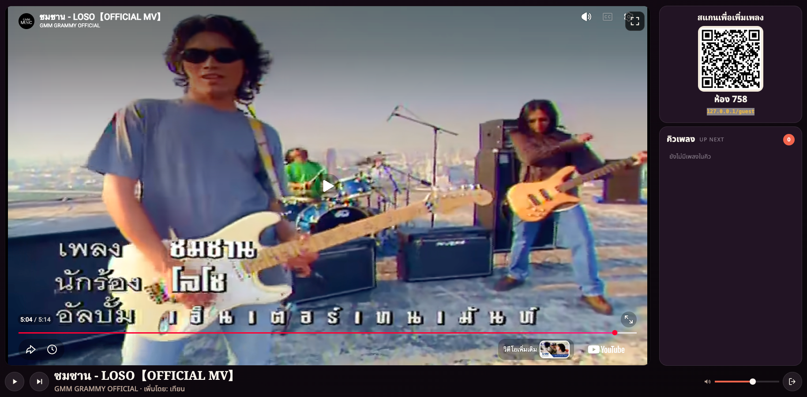
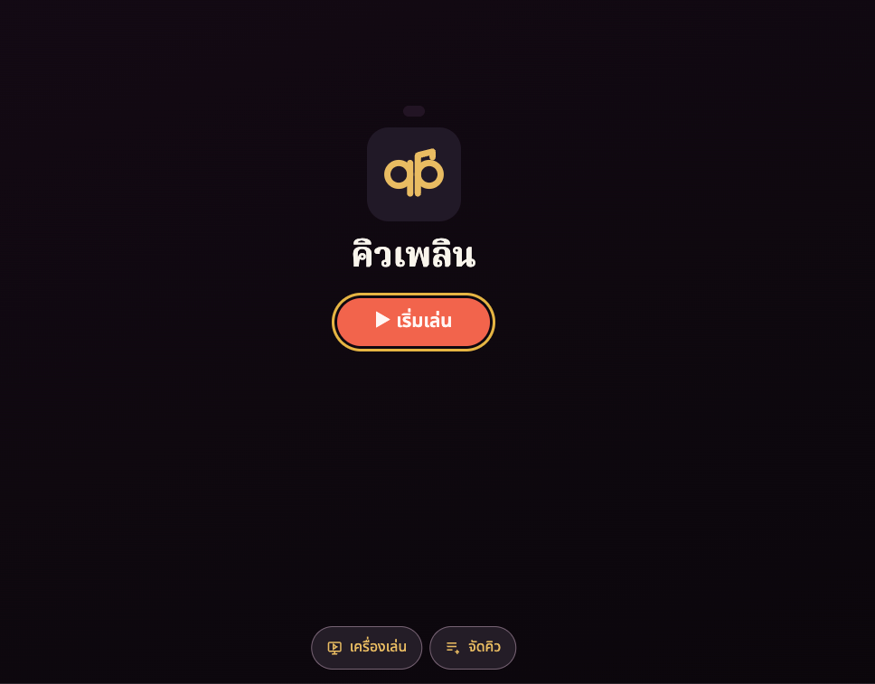
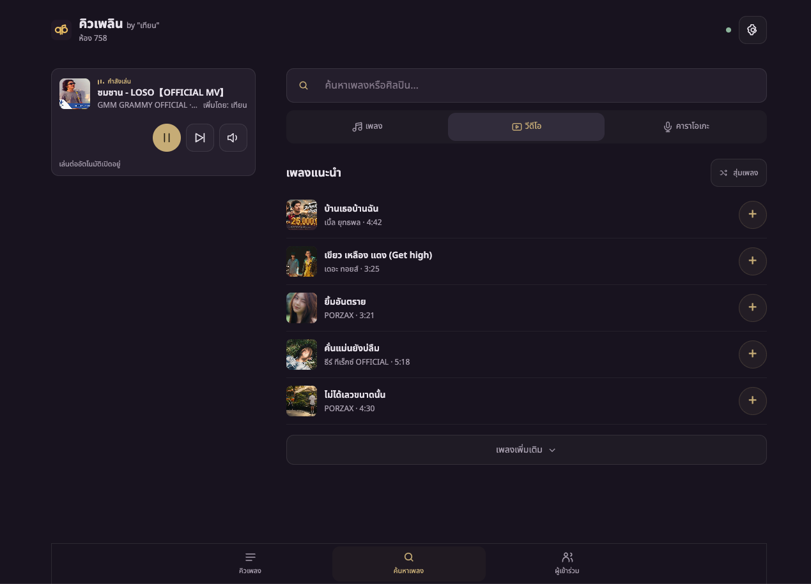

# 🎶 คิวเพลิน

คิวเพลง YouTube สำหรับงานเลี้ยง ร้านอาหาร และพื้นที่จัดกิจกรรม แขกขอเพลงจากมือถือ ผู้ดูแลจัดคิว และเครื่องเล่นแสดงวิดีโอบนทีวีหรือโปรเจกเตอร์

## Features

- **ห้องเพลงแยกกัน** กด **เริ่มเล่น** เพื่อสร้างห้องเลขสุ่มทันที หรือกด **เครื่องเล่น** แล้วกรอกเลข 3 หลักเพื่อสร้างหรือเปิดห้องนั้น แต่ละห้องมีคิวและการตั้งค่าของตัวเอง
- **ขอเพลงจากมือถือโดยไม่ต้องสมัครบัญชี** สแกน QR หรือกรอกเลขห้องผ่านปุ่ม **จัดคิว** แล้วค้นหาเพลง วิดีโอ หรือคาราโอเกะจาก YouTube เลือกจากเพลงฮิตตามประเทศที่ตั้งค่าไว้และสุ่มรายการแนะนำได้
- **จัดคิวและควบคุมเพลงแบบเรียลไทม์** Admin และ Controller ลากเรียงคิว สั่งเล่นเพลงที่เลือกทันที ลบเพลงจากคิว เล่น หยุดชั่วคราว ข้ามเพลง และปรับระดับเสียงได้
- **จัดการผู้เข้าร่วม** คนแรกที่เข้าจัดคิวได้เป็น Admin และให้หรือถอนสิทธิ์ Controller ได้ ห้องใหม่เปิดรับผู้เข้าร่วมตามค่าเริ่มต้น เมื่อ Admin ปิดรับ ผู้เข้าร่วมเดิมยังกลับเข้าได้ด้วยสิทธิ์เดิม
- **เล่นต่ออัตโนมัติและวนคิว** ห้องใหม่เปิดเล่นเพลงแนะนำอัตโนมัติเมื่อคิวเพลงที่ขอหมด เปิดโหมด **ไม่ลบคิวเพลง** เมื่อต้องการให้เพลงที่ขอกลับไปท้ายคิวเพื่อเล่นวน
- **เครื่องเล่นสำหรับจอใหญ่** รองรับวิดีโอเต็มจอ คีย์บอร์ด และรีโมตทีวี เปิดเครื่องเล่นหลายเครื่องในห้องเดียวกันเพื่อใช้เพลงปัจจุบัน คิว และระดับเสียงร่วมกันได้
- **ตั้งค่าการแสดงผลและเวลารอ** Admin เปิด–ปิด QR พร้อมเลขห้อง และเปิด–ปิดคิวเพลงบนเครื่องเล่นทุกจอได้แยกกัน รวมถึงกำหนดช่วงรอระหว่างการขอเพลง
- **ติดตั้งคิวเพลินบนหน้าจอหลัก** เปิดจากไอคอนแอปได้บนเบราว์เซอร์ที่รองรับการติดตั้ง

## วิธีใช้

1. เปิดคิวเพลินบนเครื่องที่ต่อทีวีหรือโปรเจกเตอร์ แล้วกด **เริ่มเล่น** เพื่อเปิดห้องเลขสุ่ม หรือกด **เครื่องเล่น** เพื่อเปิดห้องตามเลขที่กรอก
2. ให้แขกสแกน QR บนเครื่องเล่น หรือกด **จัดคิว** ที่หน้าแรกแล้วกรอกเลขห้อง 3 หลัก
3. ค้นหาเพลงจาก YouTube แล้วเพิ่มเข้าคิว ผู้เข้าห้องคนแรกจะเป็น Admin และควบคุมเพลงกับคิวได้
4. กดไอคอนเฟืองบนหน้าจัดคิวเพื่อเปิด **ตั้งค่าห้อง** เมื่อต้องการปรับการเล่นต่อ การแสดงผล หรือการเข้าร่วม

กด **ออกจากห้อง** บนเครื่องเล่นแล้วกดยืนยันเพื่อหยุดเฉพาะเครื่องนั้นและกลับหน้าแรก

## ภาพตัวอย่าง

### หน้าแรก

### หน้าขอเพลง

### หน้าจัดคิวของ Admin

## เครดิต

พัฒนาต่อจาก [Event Music System โดย Hangton (Hangton-Code)](https://github.com/Hangton-Code/event-music-system) ภายใต้สัญญาอนุญาต [MIT](LICENSE)
